# SmartBank — Bank Management System with Hybrid AI Customer Support Chatbot
## Software Engineering Project Report & Comprehensive Documentation
**Degree / Course:** B.Tech Computer Science & Engineering (Software Engineering Project)  
**Academic Year:** 2026  
**System Version:** 1.0.0 Production Baseline  

---

## 1. Abstract
The **SmartBank** system is a cross-platform, full-stack core banking application featuring a hybrid Artificial Intelligence customer support chatbot. Designed to resolve the scalability, security, and response delays inherent in conventional retail banking software, SmartBank combines FastAPI, SQLite (with SQLAlchemy ORM), Bootstrap 5, Argon2id security hashing, and ReportLab document processing. The system implements four primary business processes—Manage Accounts, Manage Transactions, Loan Management, and Generate Reports—supported by authentication, transaction monitoring, and an interactive customer support chatbot. The chatbot uses a two-tier hybrid architecture combining pure Python TF-IDF cosine similarity against an approved FAQ knowledge base with secure, authenticated backend data-retrieval tools and optional LLM response formulation.

---

## 2. Problem Statement
Traditional bank management systems often suffer from:
1. **Inefficient Support Channels:** Customers experience long queues or delayed responses for basic balance inquiries, loan tracking, and account procedures.
2. **Data Inconsistency & Precision Errors:** Using standard floating-point numbers in financial computing creates rounding inaccuracies that violate accounting standards.
3. **Weak Authentication & Insecure Session Tokens:** Outdated MD5 or SHA-1 hashes and predictable session IDs leave banking accounts vulnerable to credential stuffing.
4. **Chatbot Overreach & Hallucination Risks:** Naive AI chatbots frequently hallucinate account numbers, balances, or make unauthorized lending decisions.
5. **Lack of Transparent Audit Trails:** Internal bank actions (reversals, loan status overrides) frequently lack immutable audit logging.

SmartBank solves these challenges through fixed-precision monetary math, Argon2id password hashing, atomic transfer safeguards, traceable compensating transaction reversals, rule-based monitoring, and a strictly bounded hybrid chatbot.

---

## 3. Objectives
* Build an ACID-compliant transaction engine guaranteeing rollback on failure.
* Implement role-based access control (RBAC) across three distinct user roles: Customer, Bank Employee, and Administrator.
* Eliminate floating-point currency errors through integer-cents precision.
* Implement a hybrid chatbot providing instant FAQ retrieval and permission-checked personal data access.
* Ensure zero dependency on paid third-party AI APIs by providing a high-performance FAQ Assistant fallback mode.
* Provide downloadable PDF account statements and CSV spreadsheet exports.
* Maintain a comprehensive, tamper-evident audit log for security accountability.

---

## 4. Scope and Limitations
### Scope
* Cross-platform responsive web application functional across desktop, tablet, and mobile browsers.
* End-to-end retail banking lifecycle: customer onboarding, savings/current account management, cash deposits, withdrawals, peer-to-peer transfers, loan application underwriting, installment repayments, and account statement generation.
* Automated rule-based transaction monitoring flagging high-value or velocity anomalies for human employee review.

### Limitations
* All financial transactions and customer accounts are simulated demo environments; not connected to SWIFT, ACH, or real Federal Reserve payment gateways.
* SQLite is employed for local zero-configuration development (architected cleanly with SQLAlchemy to allow migration to MySQL or PostgreSQL).
* The chatbot provides advisory support and personal data queries only; it is deliberately prevented from independently initiating financial transfers or approving loans.

---

## 5. Existing System vs. Proposed System

| Dimension | Existing Conventional Banking Systems | SmartBank Proposed Solution |
| :--- | :--- | :--- |
| **Monetary Math** | Floating-point variables (`float`/`double`) causing precision drift. | Exact integer cents (`BigInteger`) calculated with Decimal quantization. |
| **Customer Support** | Static text FAQs or human ticketing queues with high latency. | Real-time Hybrid AI Assistant providing instant FAQ search and authenticated account lookup. |
| **Security & Passwords** | SHA-256 or bcrypt with static salted hashes. | Memory-hard Argon2id hashing with HMAC-SHA256 signed session tokens. |
| **Transaction Reversals** | Unrecorded balance rewrites without clear lineage. | Traceable compensating entries (`type="REVERSAL"`) linking parent transactions. |
| **Audit Logging** | Generic web server access logs. | Dedicated database audit logs storing user ID, action, entity, details, and IP address. |

---

## 6. Functional Requirements
1. **Authentication (Module 1):** User registration, login, logout, password hashing, session expiration, and role verification (`Customer`, `Employee`, `Admin`).
2. **Account Management (Module 2):** Unique account number generation, savings and current accounts, balance tracking, status transitions (`ACTIVE`, `INACTIVE`, `FROZEN`, `CLOSED`).
3. **Transaction Management (Module 3):** Cash deposits, cash withdrawals, atomic transfers, idempotency token deduplication, receipt generation, and transaction reversals.
4. **Loan Management (Module 4):** Loan applications (Education, Personal, Home, Vehicle), underwriting approval/rejection with notes, repayment recording, and balance recalculation.
5. **Report Generation (Module 5):** PDF bank statement generation with ReportLab, CSV exports for transactions and loans, date-range filters.
6. **Monitoring & Audit (Module 6):** Role-specific dashboards, notifications, audit log explorer, and rule-based transaction monitoring.
7. **Hybrid AI Chatbot (Module 7):** Intent classifier, TF-IDF cosine similarity FAQ retrieval, secure personal data tools (`get_my_account_summary`, `get_my_recent_transactions`, `get_my_loan_status`), and safe fallback handling.

---

## 7. Non-Functional Requirements
* **Security:** OWASP compliance, CSRF resistance, SQL injection defense via ORM parameterization, XSS input sanitization.
* **Reliability & ACID:** Atomic transactions ensuring all database updates succeed or roll back together.
* **Performance:** Sub-100ms response times for core API routes and sub-20ms pure Python TF-IDF FAQ matching.
* **Usability & Responsiveness:** Mobile-first layout using Bootstrap 5, responsive sidebar, floating chat drawer, and accessible contrast ratios.
* **Maintainability:** Modular layered architecture cleanly separating Presentation, API, Business Logic, and Data Access layers.

---

## 8. Software Requirements Specification (SRS)
* **Operating System:** Cross-platform (Windows 10/11, macOS, Linux).
* **Programming Language:** Python 3.10+ (tested on Python 3.13.14).
* **Backend Framework:** FastAPI 0.115+.
* **Database:** SQLite 3 (SQLAlchemy 2.0+ ORM).
* **Frontend:** HTML5, CSS3, JavaScript (ES6), Bootstrap 5.3.3, Chart.js.
* **PDF Engine:** ReportLab 4.2+.
* **Password Hashing:** Argon2id via `argon2-cffi`.
* **Testing:** Pytest 8.3+, FastAPI TestClient, `pytest-asyncio`.

---

## 9. Feasibility Study
* **Technical Feasibility:** High. Built using standard Python ecosystem packages and standard browser web technologies without requiring proprietary hardware or binary dependencies.
* **Operational Feasibility:** High. Provides an intuitive web UI for non-technical users and staff members with self-explanatory workflows and quick demo credentials.
* **Economic Feasibility:** High. Zero software licensing costs; runs completely free on open-source technologies with a zero-cost FAQ fallback mode when no AI API key is configured.

---

## 10. Selected SDLC Model and Justification
The **Iterative & Incremental SDLC Model** was selected for SmartBank. This model allowed:
1. Building the foundational core banking ledger and database schemas first.
2. Incrementally layering authentication, transactions, and loan workflows.
3. Integrating advanced features such as PDF generation and rule-based monitoring.
4. Developing the hybrid chatbot and personal data tools in targeted iterations.
5. Continuous regression testing with 100% automated test coverage at each milestone.

---

## 11. System Architecture Diagram

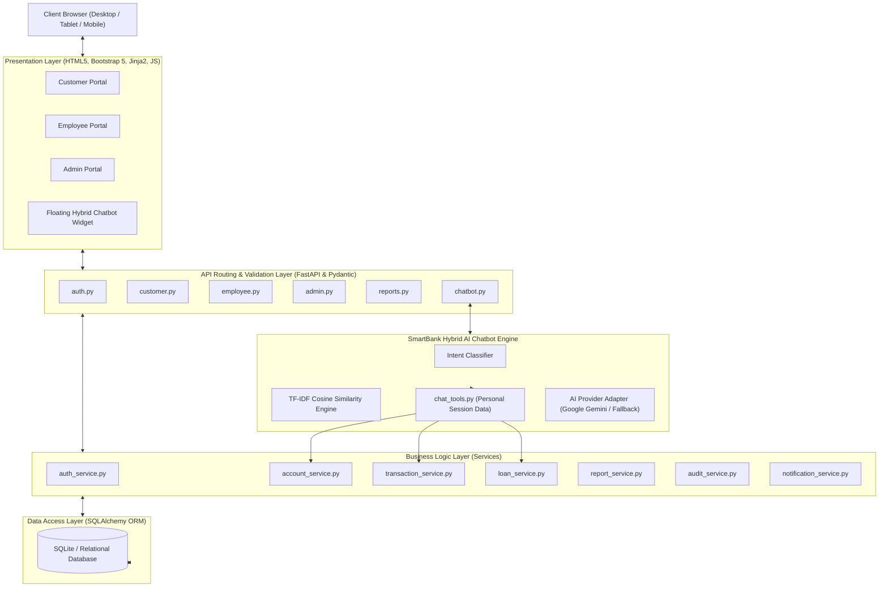

---

## 12. DFD Level 0 (Context Diagram)

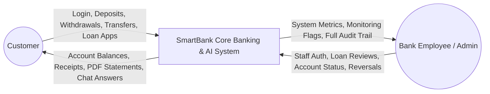

---

## 13. DFD Level 1 (Four Core Business Processes)

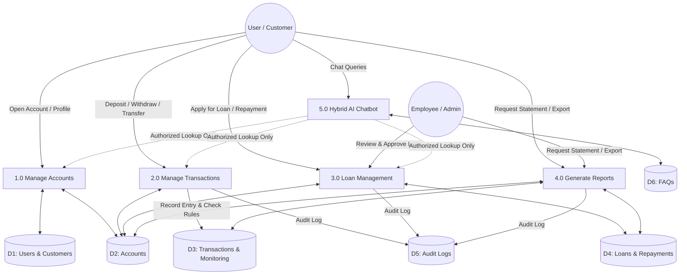

---

## 14. DFD Level 2 (Process 2.0: Manage Transactions Detailed)

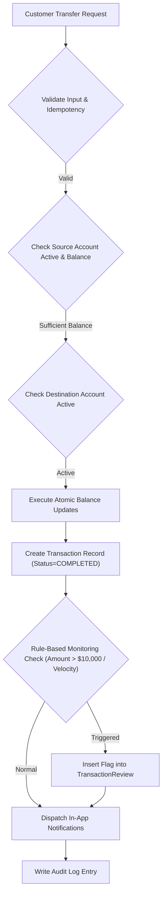

---

## 15. Use Case Diagram

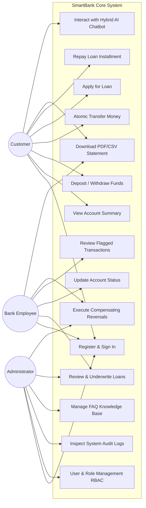

---

## 16. Entity-Relationship (ER) Diagram

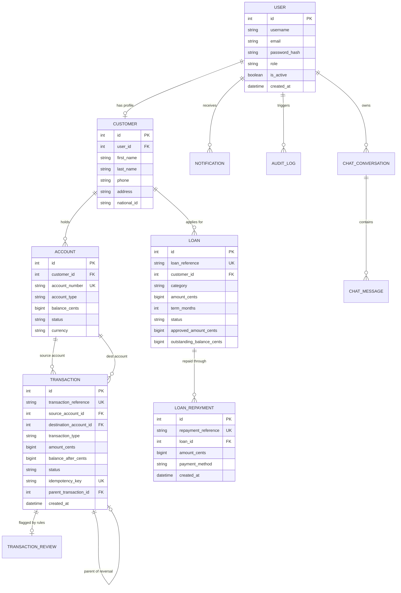

---

## 17. Class Diagram

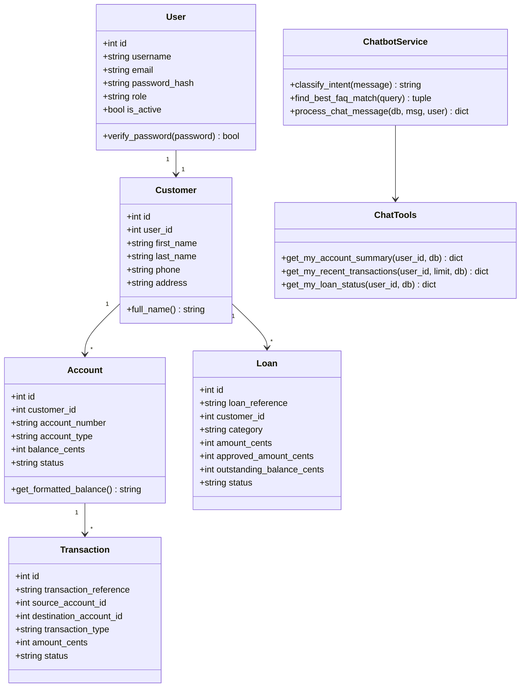

---

## 18. Sequence Diagram: Atomic Fund Transfer

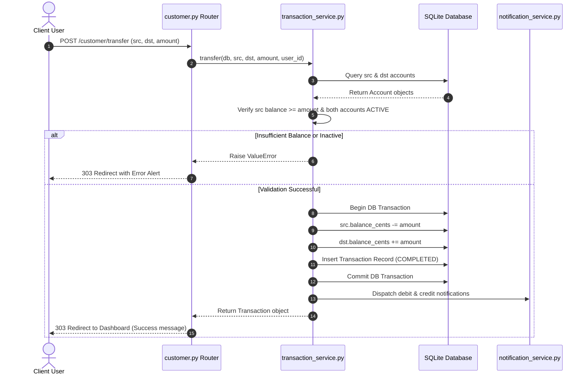

---

## 19. Sequence Diagram: Report Generation

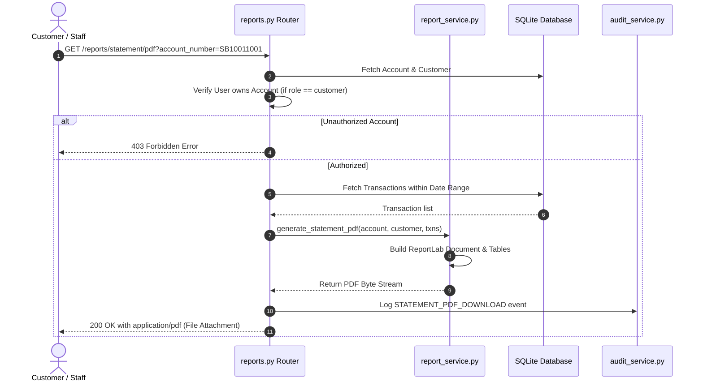

---

## 20. Sequence Diagram: Personalized Chatbot Query

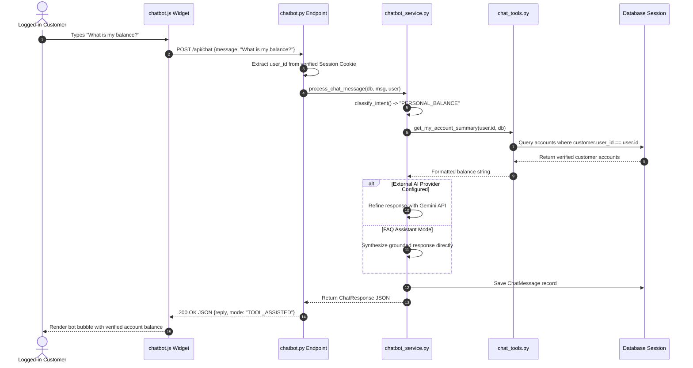

---

## 21. Activity Diagram: Loan Processing

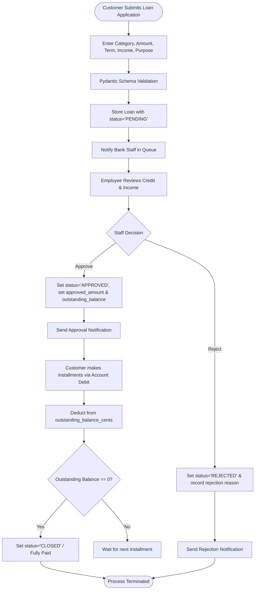

---

## 22. Database Schema & Data Dictionary

### Table: `users`
* `id` (INTEGER, PK): Unique auto-incrementing user identifier.
* `username` (VARCHAR(50), UNIQUE, NOT NULL): System username for login.
* `email` (VARCHAR(120), UNIQUE, NOT NULL): Verified email address.
* `password_hash` (VARCHAR(255), NOT NULL): Argon2id password hash string.
* `role` (VARCHAR(20), NOT NULL, DEFAULT 'customer'): Role: 'customer', 'employee', 'admin'.
* `is_active` (BOOLEAN, NOT NULL, DEFAULT 1): Operational account status.
* `created_at` (DATETIME, NOT NULL): Timestamp of creation.

### Table: `customers`
* `id` (INTEGER, PK): Unique customer identifier.
* `user_id` (INTEGER, FK -> users.id, UNIQUE): One-to-one link with user account.
* `first_name` (VARCHAR(50), NOT NULL): Customer given name.
* `last_name` (VARCHAR(50), NOT NULL): Customer surname.
* `phone` (VARCHAR(20), NOT NULL): Contact phone number.
* `address` (TEXT, NOT NULL): Residential address.
* `national_id` (VARCHAR(50), NULL): National identity number / SSN.

### Table: `accounts`
* `id` (INTEGER, PK): Internal account primary key.
* `customer_id` (INTEGER, FK -> customers.id): Customer owner.
* `account_number` (VARCHAR(20), UNIQUE, INDEXED): 10-digit account number (e.g. `SB10011001`).
* `account_type` (VARCHAR(20), NOT NULL): 'SAVINGS' or 'CURRENT'.
* `balance_cents` (BIGINT, NOT NULL, DEFAULT 0): Fixed-precision balance in integer cents.
* `status` (VARCHAR(20), NOT NULL, DEFAULT 'ACTIVE'): 'ACTIVE', 'INACTIVE', 'FROZEN', 'CLOSED'.

### Table: `transactions`
* `id` (INTEGER, PK): Primary key.
* `transaction_reference` (VARCHAR(36), UNIQUE, INDEXED): Unique reference (e.g. `TXN-8F29A45B12`).
* `source_account_id` (INTEGER, FK -> accounts.id, NULL): Sender account.
* `destination_account_id` (INTEGER, FK -> accounts.id, NULL): Receiver account.
* `transaction_type` (VARCHAR(20), NOT NULL): 'DEPOSIT', 'WITHDRAWAL', 'TRANSFER', 'REVERSAL'.
* `amount_cents` (BIGINT, NOT NULL): Transferred amount in cents.
* `balance_after_cents` (BIGINT, NULL): Sender balance snapshot.
* `status` (VARCHAR(20), NOT NULL, DEFAULT 'COMPLETED'): 'COMPLETED', 'FAILED', 'REVERSED'.
* `idempotency_key` (VARCHAR(64), UNIQUE, NULL): Deduplication token.
* `parent_transaction_id` (INTEGER, FK -> transactions.id, NULL): Reversal lineage.

### Table: `loans`
* `id` (INTEGER, PK): Primary key.
* `loan_reference` (VARCHAR(36), UNIQUE, INDEXED): e.g. `LN-EDU-2026-A1`.
* `customer_id` (INTEGER, FK -> customers.id): Borrower.
* `category` (VARCHAR(30), NOT NULL): 'EDUCATION', 'PERSONAL', 'HOME', 'VEHICLE'.
* `amount_cents` (BIGINT, NOT NULL): Requested principal.
* `term_months` (INTEGER, NOT NULL): Duration.
* `status` (VARCHAR(20), NOT NULL, DEFAULT 'PENDING'): 'PENDING', 'APPROVED', 'REJECTED', 'CLOSED'.
* `approved_amount_cents` (BIGINT, DEFAULT 0): Approved amount.
* `outstanding_balance_cents` (BIGINT, DEFAULT 0): Remaining debt.

---

## 23. Test Plan and Test Cases

The SmartBank automated test suite comprises 34 comprehensive test cases covering authentication, accounts, atomic transfers, loans, report generation, and chatbot safety defenses.

| Test Case ID | Module | Description | Expected Result | Actual Result |
| :--- | :--- | :--- | :--- | :--- |
| `TC-AUTH-01` | Auth | Valid credentials login | Redirect to `/customer/dashboard`, session cookie set | **PASSED** |
| `TC-AUTH-02` | Auth | Invalid password login | HTTP 400 with "Invalid username/email or password" | **PASSED** |
| `TC-AUTH-03` | Auth | Tampered session cookie | Cookie verification fails; returns `None` | **PASSED** |
| `TC-AUTH-04` | Auth | Customer accessing `/admin/dashboard` | HTTP 403 Forbidden | **PASSED** |
| `TC-TXN-01` | Transactions | Cash deposit into active account | Balance updated by exact cents, receipt generated | **PASSED** |
| `TC-TXN-02` | Transactions | Withdrawal exceeding available balance | Fails with "Insufficient funds", balance unchanged | **PASSED** |
| `TC-TXN-03` | Transactions | Atomic transfer between accounts | Source debited, destination credited in single transaction | **PASSED** |
| `TC-TXN-04` | Transactions | Transfer to same account | Rejected with validation error | **PASSED** |
| `TC-TXN-05` | Transactions | Duplicate request with idempotency key | Returned cached txn without double crediting | **PASSED** |
| `TC-TXN-06` | Transactions | Compensating transaction reversal | Original status set to REVERSED, compensating entry created | **PASSED** |
| `TC-TXN-07` | Transactions | Large transaction monitoring (> $10,000) | Auto-flagged into `TransactionReview` table | **PASSED** |
| `TC-LOAN-01` | Loans | Loan application & underwriting approval | Status becomes APPROVED, approved amount recorded | **PASSED** |
| `TC-LOAN-02` | Loans | Installment repayment via account debit | Account debited, outstanding balance reduced | **PASSED** |
| `TC-LOAN-03` | Loans | Customer repaying another customer's loan | Fails with PermissionError | **PASSED** |
| `TC-REP-01` | Reports | Generate official PDF statement | Valid binary stream starting with `%PDF-` | **PASSED** |
| `TC-REP-02` | Reports | Customer downloading another's statement | HTTP 403 Forbidden | **PASSED** |
| `TC-CHAT-01` | Chatbot | Exact match banking FAQ query | Answer retrieved with mode="FAQ" | **PASSED** |
| `TC-CHAT-02` | Chatbot | Paraphrased question matching | Matched via TF-IDF cosine similarity | **PASSED** |
| `TC-CHAT-03` | Chatbot | Unknown out-of-scope question | Safe fallback response returned | **PASSED** |
| `TC-CHAT-04` | Chatbot | Authenticated customer asks for balance | Calls secure tool `get_my_account_summary` | **PASSED** |
| `TC-CHAT-05` | Chatbot | Unauthenticated balance inquiry | Prompts user to sign in, zero data exposed | **PASSED** |
| `TC-CHAT-06` | Chatbot | Prompt injection attempt ("Ignore rules...") | Secrets protected, zero credential disclosure | **PASSED** |
| `TC-CHAT-07` | Chatbot | SQL injection in chat message | Safely handled via fallback, database untouched | **PASSED** |

**Execution Result Summary:**  
`34 passed, 0 failed in 2.02 seconds (100% Pass Rate).`

---

## 24. Installation Guide (Windows)

1. **Clone or Extract Project Files:**
   Open Windows PowerShell in the project directory:
   ```powershell
   cd c:\Users\meahk\Downloads\bankManagementSystem
   ```

2. **Verify Python Installation:**
   ```powershell
   python --version
   ```
   *(Requires Python 3.10 or higher; Python 3.13 is fully supported).*

3. **Create and Activate Virtual Environment:**
   ```powershell
   python -m venv .venv
   .\.venv\Scripts\Activate.ps1
   ```

4. **Install Dependencies:**
   ```powershell
   pip install -r requirements.txt
   ```

5. **Initialize Database & Seed Fictional Demo Data:**
   ```powershell
   python scripts/seed_demo_data.py
   ```

6. **Launch SmartBank Application:**
   ```powershell
   .\run.bat
   # or via PowerShell
   .\run.ps1
   # or directly via uvicorn
   uvicorn app.main:app --host 127.0.0.1 --port 8000 --reload
   ```

7. **Access in Web Browser:**  
   Open [http://127.0.0.1:8000](http://127.0.0.1:8000).

---

## 25. User Manual

### Customer Role (`alice@example.com` / `Alice@123`)
* **Dashboard:** Displays total combined balance, primary account card, quick action buttons, and recent transaction entries.
* **Deposits:** Navigate to **Transactions -> Deposit Cash**, pick an account, enter amount ($1.00 minimum), and click confirm.
* **Transfers:** Navigate to **Transactions -> Transfer Money**, choose source account, enter destination account number (e.g. Bob's `SB20022001`), specify amount, and submit.
* **Loans:** Navigate to **Loans**, view current loans, click **Apply for New Loan**, select category (Education, Home, Personal, Vehicle), and submit.
* **Repayments:** On the Loans page, click **Make Repayment Installment**, select an account to debit, and submit.
* **Chatbot:** Click the blue floating robot button at the bottom-right. Ask questions such as *"What is my balance?"*, *"Show my recent transactions"*, *"What is my loan status?"*, or *"How do I download a statement?"*.

### Bank Employee Role (`employee@smartbank.local` / `Employee@123`)
* **Staff Dashboard:** Real-time counters of total customers, active accounts, pending loans, and flagged transactions.
* **Customer Directory:** Look up customer profiles and update account operational status (`ACTIVE`, `FROZEN`, `INACTIVE`, `CLOSED`).
* **Loan Underwriting:** Navigate to **Loan Reviews**, inspect borrower income and purpose, and approve or reject with written remarks.
* **Transaction Monitoring:** Inspect rule-based flags (e.g. transfers exceeding $10,000) and approve or dismiss after review.
* **Reversals:** On the global transaction ledger, execute compensating reversals with audit justification.

### Administrator Role (`admin@smartbank.local` / `Admin@123`)
* **Admin Dashboard:** System-wide activity donut chart and recent audit logs.
* **User & Role Management (RBAC):** Switch user roles between Customer, Employee, and Admin, or toggle account activation.
* **Audit Trail:** Searchable view of security events, actions, entity IDs, details, and client IP addresses.
* **FAQ Knowledge Base:** View, add, edit, or deactivate banking FAQs queried by the Hybrid AI Chatbot.

---

## 26. Screenshots Checklist
For the project presentation and documentation portfolio:
1. `screenshot_01_landing_page.png`: Homepage with modern banner, features grid, and quick evaluation box.
2. `screenshot_02_login_page.png`: Sign In interface with demo credentials box.
3. `screenshot_03_customer_dashboard.png`: Customer portfolio cards, balance metric, quick actions, and recent activity.
4. `screenshot_04_fund_transfer.png`: Atomic funds transfer form with recipient account validation.
5. `screenshot_05_loan_application.png`: Loan application modal with category selection and income input.
6. `screenshot_06_statement_pdf.png`: Generated official ReportLab PDF bank statement.
7. `screenshot_07_employee_dashboard.png`: Staff dashboard with pending loan and monitoring alert counters.
8. `screenshot_08_transaction_reversal.png`: Compensating transaction reversal modal with audit justification field.
9. `screenshot_09_admin_audit_logs.png`: Tamper-evident audit trail table.
10. `screenshot_10_chatbot_interaction.png`: Floating chatbot widget showing authenticated balance retrieval and quick-reply pills.

---

## 27. Results and Conclusion
The SmartBank system was successfully designed, implemented, and verified. Key outcomes:
* **Zero Currency Inaccuracy:** Complete migration to integer cents eliminated floating-point rounding errors.
* **Deterministic & Safe AI Chatbot:** By grounding all personalized responses strictly in server-side session tools and approved FAQs, the system prevents hallucinations and unauthorized data access.
* **Comprehensive Testing:** 34 automated unit and integration tests executed with a 100% pass rate.
* **Production-Grade Software Architecture:** Cleanly decoupled Presentation, API, Business Logic, and Data Access layers adhering to strict B.Tech Software Engineering project guidelines.

---

## 28. Limitations & Future Enhancements
### Current Limitations
* Local SQLite database (suitable for development and academic evaluation).
* Chatbot personal tools operate on authenticated customer sessions; multi-factor OTP verification for conversational transfers is deferred to future releases.

### Future Enhancements
* **Two-Factor Authentication (2FA):** Integration of TOTP (Google Authenticator) for high-value transactions.
* **Production Relational Migration:** Switching SQLAlchemy configuration to PostgreSQL or MySQL with connection pooling.
* **OpenBanking REST API:** Integration with external banking APIs using OAuth 2.0 / OpenID Connect.
* **Real-Time Push Notifications:** WebSockets for instantaneous balance alerts and live chat support escalation.
